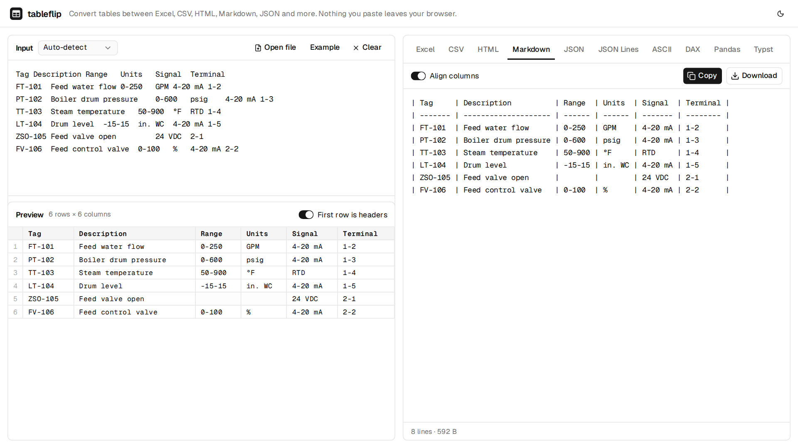

# tableflip

Convert tables between spreadsheets, documents and code, in your browser.

Paste cells from Excel or Google Sheets, a table from Word or a web page, or
CSV, JSON, Markdown or HTML text. tableflip shows a preview and writes the
table in the format you need: ready to paste back into Excel, Word or
Outlook, or as code.



## Formats

| Format           | Read | Write | Notes                                                                  |
| ---------------- | :--: | :---: | ---------------------------------------------------------------------- |
| Excel / Sheets   |  ✓   |   ✓   | Through the clipboard: paste cells in, "Copy for Excel" to paste back  |
| CSV / TSV        |  ✓   |   ✓   | Comma, semicolon, tab or pipe; the delimiter is detected               |
| HTML             |  ✓   |   ✓   | "Copy table" pastes a formatted table into Word or Outlook             |
| Markdown         |  ✓   |   ✓   | GitHub-style tables, with aligned columns                              |
| JSON             |  ✓   |   ✓   | Lists of objects or arrays; nested objects are flattened to `a.b` keys |
| JSON Lines       |  ✓   |   ✓   | Also known as NDJSON                                                   |
| ASCII            |      |   ✓   | Plain `+--+` or box-drawing borders                                    |
| DAX              |      |   ✓   | A `DATATABLE` for Power BI and Analysis Services                       |
| pandas           |      |   ✓   | Python code that builds a `DataFrame`                                  |
| Typst            |      |   ✓   | A `#table` for Typst documents                                         |

Text files (`.csv`, `.tsv`, `.txt`, `.json`, `.jsonl`, `.ndjson`, `.md`,
`.html`) can be opened or dropped onto the page. UTF-8, UTF-16 (Excel's
"Unicode Text") and Windows-1252 files are recognized.

### Pasting into Excel

"Copy for Excel" puts both tab-separated text and an HTML table on the
clipboard. With **Keep values as text** on (the default), Excel keeps values
exactly as they are instead of turning `1-2` into a date, dropping the
leading zeros from `007`, or reading `+24V` as a formula.

### Limits

tableflip handles up to 5 MB of text and 100,000 cells, and says so when
data is bigger. It's meant for everyday tables, not for large data sets.

## Privacy

Everything happens in the browser. The server only sends the app's files;
tables are never uploaded, and the app makes no other network requests.
Settings (the chosen format and its options) are saved in the browser's
local storage.

## Running it

You need Node.js 22.18 or later.

```bash
npm install
npm run dev          # development server with hot reload
```

To run the production build:

```bash
npm run build
npm start            # serves dist/ on http://127.0.0.1:3000
```

`PORT` and `HOST` change where the server listens (for example
`PORT=8080 HOST=0.0.0.0 npm start`). The server sets a strict Content
Security Policy and long-lived caching for the hashed assets. Since the app
is static, `dist/` can also be served by any static file host.

## Development

```bash
npm run typecheck
npm run lint
npm test             # unit tests (Vitest)
npm run test:e2e     # browser tests (Playwright)
```

Some unit tests check generated code with the real tools when they're
installed: Python with pandas (set `PYTHON` to its interpreter) and the
`typst` command. They're skipped otherwise.

The browser tests build the app, start the server on port 4173 (set
`E2E_PORT` to change it) and run in Chromium and Firefox. Run
`npx playwright install chromium firefox` once first.

### Layout

```
src/core/         the conversion library: readers, writers, format detection,
                  limits. No React; reading HTML needs a DOMParser.
src/components/   the UI (React, shadcn/ui on Base UI, Tailwind CSS)
src/lib/          clipboard, files, downloads and saved settings
server/           a small Hono server that serves the built app
e2e/              Playwright tests
```

## License

[MIT](LICENSE)
